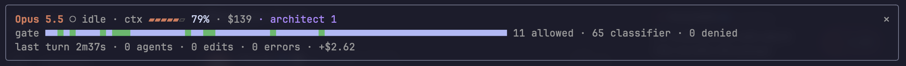

# Flightdeck

[](https://github.com/scasella/claude-flightdeck/releases/latest)
[](LICENSE)
[](https://claude.com/blog/claude-code-mods)
[](https://statuslin.es/mods/flightdeck)

> 中文版由 claude-code-mods-zh 项目翻译，原作者与许可证见文末。原版 README 见 [README.en.md](README.en.md)。

**一个把实时 agent 仪表盘放进你终端的 Claude Code mod**：上下文与成本、架构师时间线、每一次权限检查，以及以卡片或泳道展示的子 agent。每个数字都来自真实的会话事件，且不会离开你的机器。

<p align="center">
  
</p>

<p align="center">
  <a href="#安装">安装</a> · <a href="#你会看到什么">你会看到什么</a> · <a href="#它能触及什么">它能触及什么</a> · <a href="#配置">配置</a> · <a href="#故障排查">故障排查</a> · <a href="CHANGELOG.md">更新日志</a>
</p>

## 安装

在 Claude Code 内（2.1.289 或更高）：

```
/plugin marketplace add scasella/claude-flightdeck
/plugin install flightdeck@claude-flightdeck
/reload-plugins
/flightdeck
```

<details>
<summary><strong>从终端或从克隆安装</strong></summary>

```sh
claude plugin marketplace add scasella/claude-flightdeck
claude plugin install flightdeck@claude-flightdeck
```

或直接从克隆加载一个会话：

```sh
git clone https://github.com/scasella/claude-flightdeck
claude --plugin-dir ./claude-flightdeck
```

</details>

安装器可能提示某些配置选项未设置；默认值即可，可在 [`/config`](#配置) 中修改。

Mod 是 Claude Code 的早期功能，其 API 可能随版本变化。如果出问题，参见[故障排查](#故障排查)。

## 你会看到什么

https://github.com/user-attachments/assets/9ad0fcc3-c81c-427a-a743-f7b6c49f5885

<p align="center">
  
</p>

| 停靠在转录旁 | 在提示行上方内联 |
| --- | --- |
|  | <br><br>在主屏幕上（非全屏）时，面板是最多 8 行的摘要；当会话有子 agent 时，最多 3 个 agent 会加入。 |

| 面板 | 显示 | 来自 |
| --- | --- | --- |
| **main** | 模型、effort、权限模式、请求数；带压缩标记的上下文仪表（⟲，或不固定时为 ⟲~），在会话以小于模型窗口的窗口压缩时按该窗口度量；成本和前两个速率限制窗口（当套餐报告时），以及各自的重置时间（↻，56 列起）；上一个主循环请求的首 token 时间 | `turn.step`、`session.measure`、`session.compact`、`$.session.usage()` |
| **architect** | 时间线上的咨询、是否正在运行、上一次耗时；可选显示每次咨询的时刻；子 agent 架构师建议的首行 | 匹配类型的 agent 启动，或助手行中匹配的服务端工具 |
| **gate** | 每次权限检查一格：绿色=无需询问即允许，蓝色=由自动模式分类器或你决定后执行，琥珀色=待定，红色 ✗=拒绝，暗色=在子 agent 内做出；总计，以及按工具家族的下钻（凭据已屏蔽） | `tool.check`，由其周围的 `tool.call` 结算 |
| **agents** | 放得下时并排显示卡片：任务、类型、实时上下文和输出 token 数、步数、运行时钟、红色的 `max_tokens`；放不下时改为同一时间轴上的泳道 | `agent.spawn`、`turn.step`、`tool.call`、`turn.complete` |
| **loops** | 不匹配任何卡片的模型循环：工作流 agent、压缩、记忆 fork | 无卡片认领的 `turn.step` id |
| **receipt** | 正在进行的回合或上一个回合：时长、agent、编辑、错误、新增成本 | `turn.start`、`turn.complete` |
| **log** | 提示、启动、完成、咨询、编辑、错误与拒绝；查看某个 agent 的转录时只显示它 | 以上全部 |

连接线仅在有工作流动时动画：回合运行中、agent 运行中，或咨询打开时。无内容可显示的面板不占空间，因此没有子 agent 的会话只显示主框和日志。

## 使用

| 命令 | 作用 |
| --- | --- |
| `/flightdeck` | 打开面板 |
| `/flightdeck close` | 关闭面板 |
| `/flightdeck reset` | 清空 agent、检查、咨询、日志和回合（成本、速率限制和压缩计数保留） |
| `/flightdeck layout auto\|compact\|wide\|mini` | 覆盖本会话的布局 |

用 `ctrl+x tab` 聚焦面板，然后：

| 按键 | 作用 |
| --- | --- |
| `1`、`2`、… | 展开某个 agent 卡片或泳道：完整任务、最后 3 次工具调用、回答开头 |
| `f` `s` `o` | 打开闸门的文件 / shell / 其他下钻：最后 5 次检查及其结论 |

`/clear` 会随对话一起重置面板。

## 运行位置

- **全屏终端：** 停靠在转录旁；宽度 110 列以上时为两栏。
- **主屏幕终端：** 内联在提示行上方，作为 8 行摘要。
- **桌面应用、VS Code、移动端：** 同样的面板，另外 agent 会以 SVG 时间轴绘制。VS Code 和移动端无法播放动画，因此那里的连接线和时钟是静止的。

设置 `openOnStart` 后，会话启动且终端至少 144 列宽时面板会自动打开；更窄时由 `/flightdeck` 打开。颜色来自你的 Claude Code 主题，因此浅色、深色和色盲主题都可辨识。

## 它能触及什么

Flightdeck 只做观察。每个钩子都原样传递事件：它从不拒绝、重写或延迟工具调用、提示或子 agent。

| 它看到 | 通过 |
| --- | --- |
| 每次工具调用的名称与输入，以及是否失败 | `tool.call` |
| 每次权限结论 | `tool.check` |
| 子 agent 启动、其模型请求与 token 用量、其最终回答 | `agent.spawn`、`turn.step`、`turn.complete` |
| 你提示的前 70 个字符（用于日志） | `turn.start` |
| 上下文、成本和速率限制读数 | `session.measure`、`$.session.usage()` |
| `/context` 显示的上下文明细（其类别、记忆文件路径、MCP 工具、agent 与技能），本地按模型估算一次；只保留其中的压缩窗口 | `$.session.usage({ breakdown: 'summary' })` |
| 助手响应中的顾问工具调用（内容已加密） | `session.append` |

它保留什么：会话状态中的简短摘要（工具名加路径或命令、每个提示的开头、agent 的任务与回答、架构师建议，全部屏蔽凭据），随会话结束而结束。它**不**发起网络请求、不运行进程、不读写文件、不跨会话存储，也不调用模型。`claude plugin validate .` 会准确打印它挂了哪些钩子、调用了什么。

## 哪些是推断而非实测

- **架构师时刻。**“计划前”指本回合尚无编辑，“错误重复”指连续 2 个以上主循环错误，“完成前”指已发生编辑。它们标注为 `(inferred)`；可用 `moments: false` 关闭。
- **内置守卫下的压缩。** 当 Claude Code 的守卫阻止 Flightdeck 收到 `session.compact` 时，计数为估算。Claude Code 在新会话、`/clear` 或压缩后的首个响应前不报告上下文填充量。因此，若一个主循环请求在响应返回后找不到填充量，就计为一次压缩。主框显示 `⟲~1`，有余地时带 `(estimated)`，日志说 `context compacted (estimated)`。回退到首个提示也会被同样解读，因此也计入。凡 `session.compact` 运行处，其计数会取代估算。
- **服务端建议是加密的。** 对 Claude Code 的 `advisor` 这类服务端工具，面板会计数并计时，但无法显示其内容。
- **每个 agent 的上下文是最新请求的整个输入**（未缓存 + 缓存读 + 缓存写）。它标注为 `ctx` 而非成本：API 没有按 agent 的成本。
- **其他循环**无法区分工作流 agent 与压缩 fork；两者都是没有卡片认领的模型循环。
- **后台 agent 的第一步**可能在其卡片存在之前到达，因此其用量可能晚一步显示。
- **相对压缩窗口的上下文。** 当会话以小于模型窗口的窗口压缩时，仪表、`tokens/window` 和状态行的 `ctx N%` 按该窗口度量，因此读数会高于 Claude Code 自己的状态行百分比（以及 claude-hud 的），后者按模型窗口度量。自动压缩在 100% 前一点、按该窗口内的阈值运行。
- **首 token 时间。** `ttft` 在 Flightdeck 自己的 `turn.step` 钩子处计时，因此包含其下的全部：其他插件的钩子、引擎、网络和任何重试。当模型的思考未流式输出时，第一块内容在其之后到达，因此 `ttft` 包含思考时间。它是实测而非推断，但不是 API 自己的数字。没有输出速率：报告的 token 包含思考，因此按可见流计算的速率不是真实速度。

## 配置

在 `/config` 中，或用户 `settings.json` 的 `pluginConfigs[<id>].options` 下，其中 `<id>` 是 Claude Code 加载插件的方式：从市场安装时为 `flightdeck@claude-flightdeck`，用 `--plugin-dir` 时为 `flightdeck`（或 `flightdeck@inline`）。其他键下的条目或项目设置（`.claude/settings.json`）中的条目会被无警告地忽略。在终端中，`claude plugin configure flightdeck@claude-flightdeck` 会列出选项及哪些未设置，并用 `--values-stdin` 保存。

| 选项 | 默认 | 含义 |
| --- | --- | --- |
| `architectPattern` | `advisor\|architect` | 视为架构师的 agent 类型与服务端工具的不区分大小写正则 |
| `matchDescriptions` | `false` | 同时匹配 agent 描述，而不只是类型名 |
| `architectLabel` | `ARCHITECT` | 面板中架构师的名字 |
| `gateLabel` | `GATE` | 权限面板的名字 |
| `panels` | `main,architect,gate,agents,loops,receipt,log` | 显示哪些面板及其顺序 |
| `layout` | `auto` | `mini`、`compact`、`wide` 或 `auto`（内联为 mini，停靠在 110 列起为 wide） |
| `maxCards` | `3` | 改用泳道前并排的卡片数（1–6）；面板过窄时更少 |
| `paneColumns` | `66` | 停靠面板请求的列数，40 或以上。Claude Code 将停靠宽度限制为终端的 45%，你在本会话或更早会话中拖出的宽度优先。wide 布局从 110 开始，因此需要约 245 列的终端，或 `layout: wide` |
| `motion` | `while-active` | `off` 使连接线静止 |
| `moments` | `true` | 显示推断的咨询时刻 |
| `palette` | `theme` | `pastel` 使用为深色终端调好的固定配色 |
| `openOnStart` | `true` | 会话启动时询问是否打开面板 |
| `statusLine` | `true` | 在状态行显示上下文、运行中的 agent、咨询与拒绝 |

## 故障排查

**面板没有出现。**
- 检查 `claude --version` 是否为 2.1.289 或更高，然后运行 `/reload-plugins` 和 `/flightdeck`。在更旧版本上，转录会显示 `flightdeck: hooks module did not load: …`。
- 低于 144 列时，Claude Code 不会为没人请求的面板留位置；`/flightdeck` 可在任意宽度打开它。
- 在转录中寻找以 `flightdeck:` 开头的暗色行。它会指出失败的钩子或面板被拒绝的原因。请带着它[提 issue](https://github.com/scasella/claude-flightdeck/issues)。
- 如果面板只显示 `draw failed (…)`，说明其绘制钩子抛错；请把该行也放进 issue。

**VS Code 扩展中什么也不显示。** 有一份报告称其 2.1.296 构建运行了 Flightdeck 的钩子但没有显示面板，其他 mod 也没有（[#5](https://github.com/scasella/claude-flightdeck/issues/5)）。可改为在 VS Code 的集成终端中运行 `claude`，然后 `/flightdeck`：集成终端通常窄于面板自动打开所需的 144 列。

**在 Team 或 Enterprise 登录下，权限模式缺失或陈旧，压缩为估算。** 在托管设置的机器上，或在 Team/Enterprise `/login` 的会话中，Claude Code 会加载内置守卫 `cc-plugin-sec-default`，它从不在 `classic.*` 事件或 `session.compact` 上运行用户安装插件的钩子。除子 agent 启动外，用户的插件能挂钩的其他事件都不携带权限模式。因此主框在子 agent 启动前不显示模式，之后显示该启动时的模式。在此之前，自动模式下闸门会把分类器放行的调用记到 `you`。压缩改按 Claude Code 在每个请求处报告的上下文计数，因此主框标 `⟲~`，日志说 `context compacted (estimated)`。在 2.1.299 或更高版本，`/plugin` 会显示一条指出这两个钩子的说明。面板其余部分正常工作。管理员可以把 Flightdeck 安装为组织自己的 mod 来让这些钩子运行（[#23](https://github.com/scasella/claude-flightdeck/issues/23)）。

**选项似乎被忽略。** 检查用户 `settings.json` 中的键：安装时为 `pluginConfigs["flightdeck@claude-flightdeck"]`，用 `--plugin-dir` 时为 `pluginConfigs["flightdeck"]`。参见[配置](#配置)。

**颜色不对。** 在 `/config` 中把 `palette` 设为 `pastel`。

**动效太多。** 把 `motion` 设为 `off`。

**更新后计数器陈旧。** 运行 `/flightdeck reset`。

## 工作原理

| 文件 | 内容 |
| --- | --- |
| [`hooks/register.tsx`](hooks/register.tsx) | 事件钩子、状态访问，以及每个面板一个函数 |
| [`hooks/core.ts`](hooks/core.ts) | 每个 reducer、格式化器和布局规则都是纯函数，因此行为可直接测试 |
| [`hooks/rail.tsx`](hooks/rail.tsx)、[`hooks/elapsed.tsx`](hooks/elapsed.tsx) | 界面模块：动画连接线与实时时钟，只重绘自身，使用界面自己的帧时钟 |
| [`types/index.d.ts`](types/index.d.ts) | 状态契约 |
| [`tests/`](tests) | 65 个测试：纯行为，以及在 24–120 列下挂载到每个界面的绘制 |

状态存在于 `$.state` 原子中。每次读取都会合并默认值，因此缺失或较旧的字段绝不会破坏面板；改变状态形状的更新仍可能重置一次其计数器。

## 相关项目

Flightdeck 与这些项目协同工作，并从中获得灵感：

- [claude-hud](https://github.com/jarrodwatts/claude-hud)：状态行中的上下文、限制、工具与 agent。两者可同用：那个是状态行，这个是面板。
- [zoetrope](https://github.com/furkankly/zoetrope)：把 Claude Code 或 Codex 会话展示为实时流程图。
- [ccusage](https://github.com/ccusage/ccusage)：从会话日志报告成本。
- [awesome-claude-code-mods](https://github.com/karanb192/awesome-claude-code-mods)：Claude Code mod 索引。

## 开发

```sh
claude --plugin-dir .            # 加载；编辑后热重载
claude plugin validate .
claude plugin test .
npx -p typescript tsc -p .       # 首次加载后执行，它会写入 .claude-plugin/types/
```

参见 [CONTRIBUTING.md](CONTRIBUTING.md)。变更列于 [CHANGELOG.md](CHANGELOG.md)。

## 出处与许可证

- 原作者：[scasella](https://github.com/scasella/claude-flightdeck)
- 原仓库：https://github.com/scasella/claude-flightdeck
- 许可证：MIT
- 中文翻译与界面本地化：claude-code-mods-zh 项目
